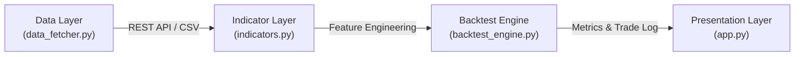
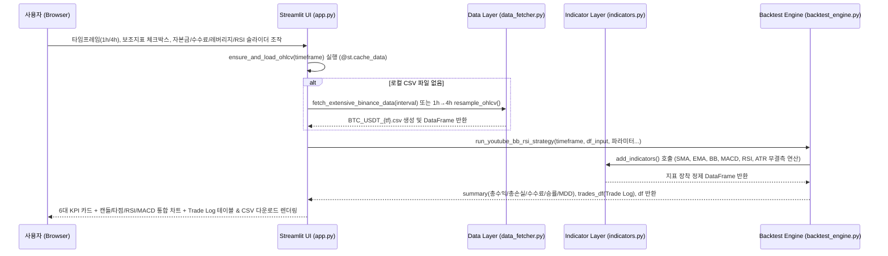

# 📊 퀀트 트레이딩 백테스팅 시스템 개발 일지 (DEVLOG)

## 1. 프로젝트 개요 및 퀀트 백테스팅 아키텍처

본 프로젝트는 암호화폐(예: `BTCUSDT`) 과거 OHLCV 데이터를 기반으로 다양한 기술적 보조지표와 레버리지/수수료 모델을 결합하여 전략의 기대수익과 리스크를 정량적으로 검증하는 **벡터 연산 기반 퀀트 백테스팅 및 시각화 시스템**입니다.

### 1.1 시스템 아키텍처 (4-Layer Pipeline)

1. **데이터 수집 계층 ([data_fetcher.py](file:///c:/Users/최정호/hanseidevelop/data_fetcher.py))**
   - Binance Public API (`/api/v3/klines`)를 호출하여 지정된 타임프레임의 대량 과거 캔들 데이터를 페이지네이션 방식으로 역순 병합 수집하고 로컬 CSV로 영속화합니다.
2. **보조지표 연산 계층 ([indicators.py](file:///c:/Users/최정호/hanseidevelop/indicators.py))**
   - 원시 OHLCV 데이터프레임에 추세, 모멘텀, 변동성, 거래량 가중 지표(SMA, EMA, Bollinger Bands, MACD, RSI, ATR, ZLSMA, Anchored VWAP 등)를 벡터 연산으로 산출하고 결측치(`NaN`, `inf`)를 완벽하게 제거하여 반환합니다.
3. **백테스팅 코어 엔진 ([backtest_engine.py](file:///c:/Users/최정호/hanseidevelop/backtest_engine.py))**
   - 진입(`entries`) 및 청산(`exits`) 시그널 배열과 손절(SL)/익절(TP), 레버리지, 왕복 수수료율을 입력받아 `vectorbt`(및 내장 폴백 시뮬레이터) 포트폴리오 시뮬레이션을 수행합니다.
   - 1시간봉(`1h`)과 4시간봉(`4h`) 타임프레임을 인자로 받아 **유튜브 볼린저 밴드 + RSI 매매 전략**(`run_youtube_bb_rsi_strategy`) 및 **ZLSMA + Chandelier Exit 돌파 전략**(`run_strategy_benchmark`)을 실행하고, 매매 진입/청산 타임스탬프와 단가, 수수료 반영 총수익/총손실, 승률, MDD를 출력 및 반환합니다.
4. **시각화 대시보드 계층 ([app.py](file:///c:/Users/최정호/hanseidevelop/app.py))**
   - `Streamlit`과 `Plotly`를 활용하여 파라미터(레버리지, 목표 익절폭 등)를 실시간 조작하고 누적 수익 곡선(Equity Curve)과 성과 요약 영수증을 비교 분석합니다.

---

## 2. 타임프레임(1시간봉, 4시간봉) 지원 방식

단기 노이즈를 줄이고 스윙/데이 트레이딩 타점의 신뢰도를 높이기 위해 **1시간봉(`1h`)** 과 **4시간봉(`4h`)** 을 핵심 타임프레임으로 지원합니다.

| 구분 | 1시간봉 (`1h`) | 4시간봉 (`4h`) |
| :--- | :--- | :--- |
| **수집 및 로드 파일** | `interval="1h"`, `BTC_USDT_1h.csv` | `interval="4h"`, `BTC_USDT_4h.csv` |
| **VectorBT 주기 (`freq`)** | `freq='1h'` (연간 8,760 캔들 기준) | `freq='4h'` (연간 2,190 캔들 기준) |
| **엔진 호출 방식** | `run_youtube_bb_rsi_strategy(timeframe="1h")` | `run_youtube_bb_rsi_strategy(timeframe="4h")` |
| **자동 리샘플링 호환** | 원본 1시간봉 시계열 그대로 보조지표 연산 | `BTC_USDT_4h.csv` 부재 시 `load_timeframe_data()` 및 `resample_ohlcv()`가 `BTC_USDT_1h.csv`를 `4h` 주기로 자동 집계(`open`: first, `high`: max, `low`: min, `close`: last, `volume`: sum) 후 보조지표 재연산 |

---

## 3. 적용 보조지표 명세 (Technical Indicators Specification)

[indicators.py](file:///c:/Users/최정호/hanseidevelop/indicators.py)의 [`add_indicators`](file:///c:/Users/최정호/hanseidevelop/indicators.py#L97-L169) 함수에서 자동 계산되어 데이터프레임에 추가되는 모든 보조지표의 수식, 기본 파라미터 및 생성 컬럼 명세입니다. 연산 완료 후 초기 웜업 구간의 `NaN` 및 `±inf` 값은 자동으로 정제(`dropna=True`)됩니다.

### 3.1 이동평균선 (Moving Averages: SMA / EMA / ZLSMA)
- **파라미터**: `sma_length=20`, `ema_length=50`, `zlsma_length=130`
- **생성 컬럼**: `SMA_20`, `EMA_50`, `ZLSMA`
- **계산 수식**:
  - **단순이동평균 ([`get_sma`](file:///c:/Users/최정호/hanseidevelop/indicators.py#L11-L13))**:
    $$\text{SMA}_n(t) = \frac{1}{n}\sum_{i=0}^{n-1} C_{t-i}$$
  - **지수이동평균 ([`get_ema`](file:///c:/Users/최정호/hanseidevelop/indicators.py#L16-L18))**: 평활 계수 $\alpha = \frac{2}{n+1}$를 적용한 재귀 지수 가중 평균
    $$\text{EMA}_n(t) = \alpha \cdot C_t + (1 - \alpha) \cdot \text{EMA}_n(t-1)$$
  - **영지연 이동평균 ([`get_zlsma`](file:///c:/Users/최정호/hanseidevelop/indicators.py#L21-L25))**: 지연 시간 $\text{lag} = \lfloor(n-1)/2\rfloor$만큼 가격 변화분을 선반영한 시계열 $D_t = C_t + (C_t - C_{t-\text{lag}})$의 지수이동평균

### 3.2 볼린저 밴드 (Bollinger Bands: 상단, 중단, 하단, 밴드폭)
- **파라미터**: `bb_length=20`, `bb_std=2.0`
- **생성 컬럼**: `BB_Upper` (상단), `BB_Middle` (중단), `BB_Lower` (하단), `BB_Width` (밴드폭, %) *(하위 호환 별칭: `BBU_20_2.0`, `BBM_20_2.0`, `BBL_20_2.0`, `BBB_20_2.0`)*
- **계산 수식 ([`get_bbands`](file:///c:/Users/최정호/hanseidevelop/indicators.py#L28-L47))**:
  $$\text{BB\_Middle}_t = \text{SMA}_{20}(C_t), \quad \sigma_t = \sqrt{\frac{1}{20}\sum_{i=0}^{19}\left(C_{t-i} - \text{BB\_Middle}_t\right)^2}$$
  $$\text{BB\_Upper}_t = \text{BB\_Middle}_t + 2.0 \cdot \sigma_t, \quad \text{BB\_Lower}_t = \text{BB\_Middle}_t - 2.0 \cdot \sigma_t$$
  $$\text{BB\_Width}_t (\%) = \frac{\text{BB\_Upper}_t - \text{BB\_Lower}_t}{\text{BB\_Middle}_t} \times 100$$

### 3.3 MACD (Moving Average Convergence Divergence)
- **파라미터**: `macd_fast=12`, `macd_slow=26`, `macd_signal=9`
- **생성 컬럼**: `MACD_Line`, `MACD_Signal`, `MACD_Hist`
- **계산 수식 ([`get_macd`](file:///c:/Users/최정호/hanseidevelop/indicators.py#L50-L66))**:
  $$\text{MACD\_Line}_t = \text{EMA}_{12}(C_t) - \text{EMA}_{26}(C_t)$$
  $$\text{MACD\_Signal}_t = \text{EMA}_{9}(\text{MACD\_Line}_t)$$
  $$\text{MACD\_Hist}_t = \text{MACD\_Line}_t - \text{MACD\_Signal}_t$$

### 3.4 RSI (Relative Strength Index)
- **파라미터**: `rsi_length=14` (과매도 기준 `30.0`, 과매수 기준 `70.0`)
- **생성 컬럼**: `RSI_14`, `RSI`
- **계산 수식 ([`get_rsi`](file:///c:/Users/최정호/hanseidevelop/indicators.py#L69-L84))**: Wilder's Smoothing ($\alpha = 1/14$) 기반
  $$\Delta C_t = C_t - C_{t-1}, \quad U_t = \max(\Delta C_t, 0), \quad D_t = \max(-\Delta C_t, 0)$$
  $$\overline{U}_t = \text{EWM}_{\alpha=1/14}(U_t), \quad \overline{D}_t = \text{EWM}_{\alpha=1/14}(D_t)$$
  $$\text{RS}_t = \frac{\overline{U}_t}{\overline{D}_t}, \quad \text{RSI}_t = 100 - \frac{100}{1 + \text{RS}_t}$$

### 3.5 ATR (Average True Range)
- **파라미터**: `atr_length=14` (전략별 커스텀 `22` 지원)
- **생성 컬럼**: `ATR_14`, `ATR`
- **계산 수식 ([`get_atr`](file:///c:/Users/최정호/hanseidevelop/indicators.py#L87-L94))**:
  $$\text{TR}_t = \max\left(H_t - L_t, \; |H_t - C_{t-1}|, \; |L_t - C_{t-1}|\right)$$
  $$\text{ATR}_t = \text{EWM}_{\alpha = 1/n}(\text{TR}_t)$$

---

## 4. 탑재된 백테스팅 매매 전략 명세

### 4.1 유튜브 대표 매매 전략: 볼린저 밴드 하단 터치 + RSI 과매도 반등 롱 전략
- **구현 함수**: [`run_youtube_bb_rsi_strategy`](file:///c:/Users/최정호/hanseidevelop/backtest_engine.py#L244-L337) ([backtest_engine.py](file:///c:/Users/최정호/hanseidevelop/backtest_engine.py))
- **지원 타임프레임**: `timeframe="1h"` (1시간봉) 및 `timeframe="4h"` (4시간봉)
- **기본 파라미터**:
  - 볼린저 밴드: `bb_length=20`, `bb_std=2.0`
  - RSI: `rsi_length=14`, `rsi_oversold=30.0`, `rsi_overbought=70.0`
  - 자본금 및 수수료: `init_cash=10000.0`, `fee_rate=0.0004` (편도 0.04%)
- **매매 진입 규칙 (Long Entry)**:
  1. **밴드 하단 터치 조건 (`bb_lower_touch`)**: 현재 캔들 또는 직전 캔들의 저가(`low`)가 볼린저 밴드 하단선(`BB_Lower`) 이하로 터치/이탈 ($L_t \le \text{BB\_Lower}_t \;\lor\; L_{t-1} \le \text{BB\_Lower}_{t-1}$)
  2. **RSI 과매도 및 반등 조건**:
     - 표준 모드(`strict_rebound=False`): 당일 볼린저 하단 터치와 동시에 $\text{RSI}_t \le 30$에 진입하거나, 직전/당일 하단 터치 및 과매도($\le 30$) 도달 이후 $\text{RSI}_t > \text{RSI}_{t-1}$로 모멘텀이 상향 반등할 때 롱(Long) 진입
     - 엄격 반등 모드(`strict_rebound=True`): 하단 터치 및 과매도($\le 30$) 확인 후 양봉($C_t \ge O_t$)과 함께 $\text{RSI}_t > \text{RSI}_{t-1}$ 반등이 동시에 발생할 때만 진입
- **매매 청산 규칙 (Long Exit)**:
  1. **밴드 상단 터치 (`bb_upper_touch`)**: 캔들의 고가(`high`) 또는 종가(`close`)가 볼린저 밴드 상단선(`BB_Upper`)에 도달/돌파 ($H_t \ge \text{BB\_Upper}_t \;\lor\; C_t \ge \text{BB\_Upper}_t$)
  2. **RSI 과매수 도달 (`rsi_overbought_hit`)**: $\text{RSI}_t \ge 70$ 도달 시 즉시 전량 익절/청산

### 4.2 ZLSMA + Chandelier Exit 추세 돌파 벤치마크 전략
- **구현 함수**: [`run_strategy_benchmark`](file:///c:/Users/최정호/hanseidevelop/backtest_engine.py#L340-L407)
- **매매 규칙**: `ZLSMA(130)` 상단에서 `ATR(22) * 3` 기반 `CE_Short` 돌파 시 진입(종가 마감 확인 vs 실시간 고가 돌파 비교), `CE_Long` 하향 이탈 또는 진입가 대비 `1.5 * ATR` 하락 시 손절, 목표 익절 `0.4%`.

---

## 5. 성과 지표 계산 공식 및 거래 기록(Trade Log) 데이터 구조

### 5.1 핵심 성과 지표 수식 (수수료 및 레버리지 반영)

초기 자본금을 $C_0$, 레버리지 배율을 $L$, 편도 거래 수수료율을 $f$ (예: `0.0004` = 0.04%), $i$번째 거래의 진입 단가를 $P_{\text{in}, i}$, 청산 단가를 $P_{\text{out}, i}$라 할 때:

1. **개별 거래 지불 수수료 (Trade Fee Paid)**
   $$\text{Fee}_i = C_0 \cdot L \cdot \left( f + f \cdot \frac{P_{\text{out}, i}}{P_{\text{in}, i}} \right)$$
2. **개별 거래 순손익 (Net PnL)**
   $$r_{\text{net}, i} = \max\left(-1.0, \; r_{1\times, i} \cdot L\right), \quad \text{NetPnL}_i = C_0 \cdot r_{\text{net}, i}$$
3. **총수익 (Total Gross Profit, 수수료 반영)** 및 **총손실 (Total Gross Loss, 수수료 반영)**
   $$\text{Total Gross Profit} = \sum_{i \,:\, \text{NetPnL}_i > 0} \text{NetPnL}_i, \quad \text{Total Gross Loss} = \sum_{i \,:\, \text{NetPnL}_i \le 0} \text{NetPnL}_i$$
4. **승률 (Win Rate)** 및 **최대 낙폭 (MDD)**
   $$\text{Win Rate (\%)} = \frac{N_{\text{win}}}{N_{\text{total}}} \times 100, \quad \text{MDD (\%)} = \min_{k} \left(\frac{E_k - \max_{0 \le j \le k} E_j}{\max_{0 \le j \le k} E_j}\right) \times 100$$

### 5.2 거래 기록 (Trade Log) 표준 데이터 구조

[`extract_backtest_metrics`](file:///c:/Users/최정호/hanseidevelop/backtest_engine.py#L62-L162)가 반환하는 `trades_df`의 스키마입니다.

| 컬럼명 (Field) | 데이터 타입 | 설명 |
| :--- | :--- | :--- |
| `trade_id` | `int` | 거래 고유 순번 (1부터 시작) |
| `entry_timestamp` | `datetime64[ns]` | 매매 진입 캔들의 타임스탬프 (`df.index[entry_idx]`) |
| `exit_timestamp` | `datetime64[ns]` | 매매 청산 캔들의 타임스탬프 (`df.index[exit_idx]`) |
| `direction` | `str` | 포지션 방향 (`Long` 또는 `Short`) |
| `entry_price` | `float` | 진입 체결 단가 ($) |
| `exit_price` | `float` | 청산 체결 단가 ($) |
| `gross_return_pct` | `float` | 수수료 차감 전 순수 가격 변동 수익률 (%, 레버리지 반영) |
| `fee_paid` | `float` | 진입 + 청산 왕복 지불 수수료 금액 ($, 레버리지 반영) |
| `net_return_pct` | `float` | 수수료 차감 후 최종 수익률 (%, 레버리지 반영 및 강제청산 하한 -100% 적용) |
| `net_pnl` | `float` | 수수료 차감 후 최종 실현 손익금 ($) |
| `cumulative_equity` | `float` | 해당 거래 청산 직후 누적 계좌 잔고 ($) |
| `status` | `str` | 포지션 상태 (`Closed` 또는 `Open`) |

---

## 6. 단계별 개발 진행 체크리스트 (Phase Roadmap)

### Phase 1: 아키텍처 분석 및 백테스트 코어 정밀화 (완료)
- [x] 기존 워크스페이스 4대 모듈(`data_fetcher.py`, `indicators.py`, `backtest_engine.py`, `app.py`) 구조 분석
- [x] `DEVLOG.md` 아키텍처, 타임프레임, 보조지표, 성과 수식 및 Trade Log 데이터 구조 명세화
- [x] `backtest_engine.py` 매매 진입/청산 타임스탬프(`entry_timestamp`, `exit_timestamp`) 추출 로직 추가
- [x] 수수료가 반영된 총수익(`total_gross_profit`), 총손실(`total_gross_loss`), 총수수료(`total_fees`), MDD(`mdd_pct`) 산출 및 구조화된 결과(`summary`, `trades_df`) 반환 보완

### Phase 2: 멀티 타임프레임(1H / 4H) 및 보조지표 통합 + 유튜브 매매 전략 탑재 (완료)
- [x] `indicators.py`에 이동평균선(`SMA`, `EMA`, `ZLSMA`), 볼린저 밴드(`BB_Upper`, `BB_Middle`, `BB_Lower`, `BB_Width`), `MACD`(`MACD_Line`, `MACD_Signal`, `MACD_Hist`), `RSI`, `ATR`, `AVWAP_Weekly` 통합 및 결측치 자동 제거 완성
- [x] `backtest_engine.py`에서 `indicators.py`의 함수들을 단일 임포트하도록 모듈 간 결합도 정비
- [x] `backtest_engine.py`에 유튜브 대표 매매 전략(볼린저 밴드 하단 터치 + RSI 30 이하 과매도 반등 롱 진입 / 볼린저 상단 터치 또는 RSI 70 이상 과매수 청산) 함수 `run_youtube_bb_rsi_strategy()` 구현
- [x] `1h` 및 `4h` 타임프레임 인자 지원(4h CSV 부재 시 1h 데이터 자동 리샘플링 포함) 및 상세 매매기록(진입/청산 시간, 단가, 수수료, 순손익) 리포트 출력 연결

### Phase 3: 전략 고도화 및 리스크 관리 (손익비 개선)
- [ ] 볼린저 밴드 밴드폭(`BB_Width`) 스퀴즈 필터 및 `MACD_Hist` 모멘텀 필터를 결합한 다중 조건 승률 비교 실험
- [ ] `ATR` 기반 동적 손절(Stop-Loss) 및 리스크 대비 보상 비율(Risk-Reward Ratio) 익절 결합
- [ ] 4시간봉 거시 추세(`EMA_50`) 필터 + 1시간봉 `BB + RSI` 타점 결합(MTF 전략) 백테스팅 구현

### Phase 4: Streamlit UI 고도화 (`app.py` 백테스팅 전용 대시보드 전면 개편) (완료)
- [x] 사이드바 컨트롤 패널 구현 (타임프레임 `1h`/`4h` 선택 드롭다운 및 데이터 부재 시 `data_fetcher` 자동 수집 / 리샘플링 연동)
- [x] 보조지표 오버레이/서브플롯 표시 토글 체크박스 구현 (`SMA/EMA`, `Bollinger Bands`, `RSI`, `MACD`)
- [x] 백테스팅 파라미터 실시간 조절 위젯 구현 (초기 자본금 `10,000 USDT`, 수수료율 `0.05%`, 레버리지 배율, RSI 과매도/과매수 슬라이더)
- [x] 메인 상단 6대 핵심 성과 요약 카드(`st.metric`) 배치: 총수익률(%), 총수익금(Gross Profit), 총손실금(Gross Loss), 총 지불 수수료(Fees), 승률(Win Rate), 최대 낙폭(MDD)
- [x] Plotly `make_subplots` 기반 인터랙티브 캔들차트 + 볼린저 밴드/이동평균선 오버레이 + 롱 진입(초록 삼각형 화살표) / 청산(빨간 X 마커) 타점 시각화 + RSI/MACD 연동 서브플롯 구현
- [x] 하단 상세 매매 기록(`Trade Log`) 데이터프레임 출력 및 UTF-8 BOM(`utf-8-sig`) 인코딩 기반 `CSV 다운로드` 버튼 탑재

#### 4.1 대시보드 UI 구성 요소 명세 ([app.py](file:///c:/Users/최정호/hanseidevelop/app.py))

| 영역 | 세부 컴포넌트 | 연동 데이터 및 주요 기능 |
| :--- | :--- | :--- |
| **사이드바 컨트롤 패널** | 타임프레임 드롭다운 (`1h` / `4h`) | [`ensure_and_load_ohlcv`](file:///c:/Users/최정호/hanseidevelop/app.py#L24-L60) 호출. 로컬 CSV 부재 시 `1h`→`4h` 자동 리샘플링 또는 [`fetch_extensive_binance_data`](file:///c:/Users/최정호/hanseidevelop/data_fetcher.py#L6-L55)로 바이낸스 API 자동 수집 |
| **사이드바 컨트롤 패널** | 보조지표 체크박스 4종 | `이동평균선(SMA 20 / EMA 50)`, `볼린저 밴드(Upper/Mid/Lower)`, `RSI`, `MACD` 표시 여부를 동적으로 토글하고 서브플롯 행(Row) 구성을 자동 재조정 |
| **사이드바 컨트롤 패널** | 백테스팅 파라미터 위젯 | 초기 자본금(기본 `10,000 USDT`), 편도 수수료율(기본 `0.05%`), 레버리지(`1x~50x`), RSI 과매도/과매수 기준 범위 슬라이더(기본 `30 / 70`) |
| **메인 상단 요약 카드** | 6-Column KPI Metrics (`st.columns(6)`) | `총 수익률(%)`, `총 수익금(Gross Profit)`, `총 손실금(Gross Loss)`, `총 지불 수수료(Fees)`, `승률(Win Rate)`, `최대 낙폭(MDD)` 및 최종 계좌 자산 표시 |
| **메인 & 서브 차트** | Plotly `make_subplots` 다중 패널 | **Row 1**: 캔들차트 + SMA/EMA + 볼린저 밴드 영역 채우기(`tonexty`) + 롱 진입(`triangle-up`, 초록) / 청산(`x`, 빨강) 마커 오버레이 **Row 2~3**: `RSI`(과매도/과매수 기준선 포함) 및 `MACD`(Line, Signal, 양/음수 색상 구분 Histogram) X축 동기화(`shared_xaxes=True`) |
| **하단 Trade Log 섹션** | 상세 거래 데이터프레임 & 다운로드 | 진입 시각, 청산 시각, 진입가, 청산가, 지불 수수료, 최종 수익률(%), 실현 손익금($), 누적 잔고를 한글 컬럼으로 출력하고 **`📥 Trade Log CSV 다운로드`**(`st.download_button`) 제공 |

#### 4.2 백테스팅 인터랙션 파이프라인 (UI ↔ Engine Data Flow)

---

## 7. 변경 이력 (Changelog)

| 날짜 | 작업자 | 대상 파일 | 변경 요약 |
| :--- | :--- | :--- | :--- |
| 2026-10-22 | Antigravity | `DEVLOG.md`, `backtest_engine.py` | 초기 `DEVLOG.md` 생성 및 `backtest_engine.py` 내 진입/청산 타임스탬프 매핑, 수수료 반영 총수익/총손실/MDD/Trade Log 반환 구조 보완 |
| 2026-10-22 | Antigravity | `indicators.py`, `backtest_engine.py`, `DEVLOG.md` | `indicators.py` 5대 핵심 보조지표(SMA/EMA, BB 상·중·하·폭, MACD, RSI, ATR) 무결측 연산 고도화, `backtest_engine.py`에 1H/4H 지원 유튜브 BB+RSI 매매 전략(`run_youtube_bb_rsi_strategy`) 탑재 및 `DEVLOG.md` 수식/규칙 문서화 |
| 2026-10-22 | Antigravity | `app.py`, `DEVLOG.md` | `app.py`를 백테스팅 전용 완성형 대시보드로 전면 개편(1H/4H 자동 수집·변환, 보조지표 토글, 파라미터 슬라이더, 6대 KPI 카드, 진입/청산 마커 캔들차트 & RSI/MACD 서브차트, Trade Log 및 CSV 다운로드) 및 `DEVLOG.md` Phase 4 문서화 완료 |
| 2026-10-22 | Antigravity | `indicators.py`, `DEVLOG.md` | `get_bbands()` 내 볼린저 밴드 표준편차 연산 시 `NDFrame.rolling()`의 `ddof` 인자 위치 오류 수정 (`series.rolling(window=length).std(ddof=0)`) |
