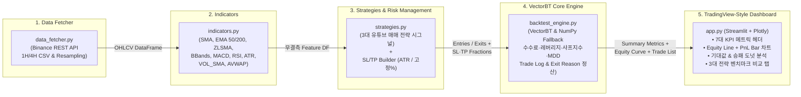

# ⚡ 암호화폐 선물 다중 전략 퀀트 백테스팅 및 트레이딩뷰 스타일 웹 대시보드 시스템

> **Cryptocurrency Futures Multi-Strategy Quant Backtesting & TradingView-Style Web Dashboard System**  
> **1시간봉(1H) · 4시간봉(4H) 스윙 매매 및 유튜브 대표 알고리즘 전략의 정량적 검증 플랫폼**

---

## 📌 1. 프로젝트 개요 및 배경 (Overview & Background)

암호화폐 선물(Futures) 시장에서는 높은 변동성과 레버리지(Leverage)로 인해 검증되지 않은 매매 기법을 적용할 경우 심각한 원금 손실(청산) 위험에 노출됩니다. 특히 유튜브나 커뮤니티에서 널리 회자되는 **"고승률 매매법"** 들은 대부분 ① 거래소 왕복 수수료, ② 레버리지 배율에 따른 손실 증폭, ③ 횡보장과 추세장에서의 최대 낙폭(MDD)을 엄밀하게 반영하지 않은 채 단편적인 차트 구간만을 제시하는 한계가 있습니다.

본 프로젝트는 이러한 문제를 해결하기 위해 설계된 **벡터 연산 기반 다중 전략 퀀트 백테스팅 및 초경량 시각화 웹 플랫폼**입니다.

### 🎯 핵심 설계 목적
1. **1시간봉(1H) / 4시간봉(4H) 스윙 매매 정밀 검증**: 초단타(1분봉/5분봉)의 과도한 노이즈와 수수료 손실을 배제하고, 스윙 트레이딩에 최적화된 1H·4H 타임프레임 데이터를 자동 수집·리샘플링하여 검증합니다.
2. **유튜브 대표 3대 매매 전략의 객관적 벤치마크**: 역추세(볼린저 밴드+RSI), 추세추종(EMA 200+MACD), 변동성 돌파(볼린저 스퀴즈+거래량 급증) 전략을 동일한 데이터·수수료·레버리지 조건에서 정량 비교합니다.
3. **ATR 변동성 적응형 리스크 관리**: 고정 퍼센트(%) 손절/익절뿐만 아니라 시장 변동성(ATR)에 비례하는 동적 손절/익절(SL/TP) 모델을 탑재하여 손익비(Payoff Ratio)와 프로핏 팩터(Profit Factor) 개선 효과를 측정합니다.
4. **TradingView 전략 테스터 스타일 초경량 UI**: 수천 개 캔들을 렌더링하며 발생하는 브라우저 병목(렉)을 완전히 제거하고, 누적 자산 증식 곡선(Equity Curve)과 건별 손익(Trade PnL) 바 차트, 승패 도넛 차트, 거래목록(Trade List) 중심의 고성능 대시보드를 구현했습니다.

---

## 🏗️ 2. 시스템 아키텍처 (System Architecture)

본 시스템은 데이터 수집부터 보조지표 연산, 전략 시그널 및 리스크 관리, 벡터 백테스팅 코어, 웹 대시보드까지 **5계층 모듈형 파이프라인**으로 구성됩니다.



### 📂 디렉토리 및 파일 구조
```text
📦 hanseidevelop
 ┣ 📜 data_fetcher.py      # 바이낸스 선물/현물 과거 캔들(10,000봉) 페이지네이션 수집기
 ┣ 📜 indicators.py        # 이동평균, 볼린저 밴드, MACD, RSI, ATR, AVWAP 벡터 연산 모듈
 ┣ 📜 strategies.py        # 유튜브 3대 매매 전략 시그널 생성 모듈 (BB+RSI, EMA200+MACD, BB Squeeze)
 ┣ 📜 backtest_engine.py   # VectorBT & 내장 폴백 시뮬레이터, SL/TP·수수료·샤프지수·벤치마크 엔진
 ┣ 📜 app.py               # TradingView 전략 테스터 스타일 초경량 Streamlit 웹 대시보드
 ┣ 📜 requirements.txt     # 프로젝트 필수 파이썬 패키지 명세서
 ┣ 📜 DEVLOG.md            # 아키텍처 설계, 수식 증명 및 Phase 1~6 개발 일지
 ┗ 📜 README.md            # 프로젝트 종합 문서 (현재 파일)
```

---

## 📐 3. 핵심 보조지표 및 3대 유튜브 매매 전략 명세

### 3.1 자동 산출 기술적 보조지표 ([indicators.py](file:///c:/Users/최정호/hanseidevelop/indicators.py))

| 분류 | 지표명 (컬럼명) | 기본 파라미터 | 수식 및 핵심 역할 |
| :--- | :--- | :--- | :--- |
| **추세 (Trend)** | `SMA_20`, `EMA_50`, `EMA_200`, `ZLSMA` | `20`, `50`, `200`, `130` | 단·중·장기 추세 필터링 및 영지연(Zero-Lag) 추세선 산출 |
| **변동성 (Volatility)** | `BB_Upper`, `BB_Middle`, `BB_Lower`, `BB_Width` | `length=20`, `std=2.0` | $\text{Mid} \pm 2\sigma$ 상·하단 채널 및 밴드폭($\frac{\text{Upper}-\text{Lower}}{\text{Mid}}\times 100$) 스퀴즈 판별 |
| **변동성 (Volatility)** | `ATR_14` (`ATR`) | `length=14` | $\text{TR}_t = \max(H-L, |H-C_{t-1}|, |L-C_{t-1}|)$의 Wilder 평활, 동적 SL/TP 기준 |
| **모멘텀 (Momentum)** | `MACD_Line`, `MACD_Signal`, `MACD_Hist` | `fast=12, slow=26, sig=9` | 장단기 지수이동평균 수렴·확산 및 골든/데드크로스 타점 포착 |
| **오실레이터 (Oscillator)** | `RSI_14` (`RSI`) | `length=14` | 상승폭/하락폭 상대 강도(0~100), 과매도($\le 30$) 및 과매수($\ge 70$) 판별 |
| **거래량 (Volume)** | `VOL_SMA_20`, `AVWAP_Weekly` | `20`, `W-MON` | 20봉 거래량 이동평균(거래량 급증 판별) 및 주간 초기화 거래량 가중 평균가 |

---

### 3.2 탑재된 3대 유튜브 매매 전략 ([strategies.py](file:///c:/Users/최정호/hanseidevelop/strategies.py))

| 전략 구분 | 전략명 | 매매 진입 조건 (Long Entry) | 매매 청산 조건 (Long Exit) | 전략 특성 |
| :--- | :--- | :--- | :--- | :--- |
| **전략 1 (역추세)** | **볼린저 밴드 + RSI 과매도 반등** (`signals_bb_rsi`) | 캔들 저가가 `BB_Lower` 이하로 터치/이탈하고, `RSI ≤ 30` 과매도 진입 또는 과매도 직후 RSI 상향 반등 시 진입 | 캔들 고가/종가가 `BB_Upper`에 도달하거나 `RSI ≥ 70` 과매수 도달 시 청산 | 박스권 횡보장에서 높은 승률을 기록하나 강한 하락 추세에서 연속 손절 주의 |
| **전략 2 (추세추종)** | **EMA 200 추세 필터 + MACD 골든크로스** (`signals_ema_macd`) | 종가가 장기 추세선 `EMA_200` 위에 위치($C_t > \text{EMA}_{200}$)하며 `MACD_Line`이 `MACD_Signal`을 상향 돌파(골든크로스)할 때 진입 | `MACD` 데드크로스 발생 시 또는 종가가 `EMA_200`을 하향 이탈할 때 청산 | 대세 상승장 초입에 진입하여 큰 추세 수익을 추구하며 역추세 매매를 원천 배제 |
| **전략 3 (변동성 돌파)** | **볼린저 밴드 스퀴즈 + 거래량 급증 돌파** (`signals_bb_squeeze`) | 직전 5봉 이내 밴드폭(`BB_Width`)이 최근 120봉 하위 20% 이하로 수축(Squeeze)한 뒤, 종가가 `BB_Upper`를 상향 돌파하고 거래량이 `VOL_SMA_20`의 2배 이상 급증할 때 진입 | 종가가 볼린저 중심선(`BB_Middle`)을 하향 이탈할 때 청산 | 에너지 응축 후 거래량을 동반한 진짜 추세 폭발(Breakout) 구간만 선별 타격 |

---

## 🛡️ 4. 리스크 관리 및 수수료·레버리지 정산 모델

### 4.1 ATR 변동성 기반 vs 고정 % 기반 SL/TP ([`build_sl_tp_fractions`](file:///c:/Users/최정호/hanseidevelop/backtest_engine.py#L335-L359))
진입 시점 캔들 $t$의 체결가를 $P_{\text{in}}$, 당시 ATR 값을 $\text{ATR}_t$라 할 때, 포지션 보유 기간 동안 아래의 손절가($P_{\text{SL}}$)와 익절가($P_{\text{TP}}$)가 고정 적용되며 전략 청산 시그널보다 먼저 도달하면 즉시 청산(`exit_reason = SL` 또는 `TP`)됩니다.

- **ATR 변동성 기반 모드** (기본 $k_{\text{SL}} = 1.5,\; k_{\text{TP}} = 3.0$, 손익비 $1:2$):
  $$P_{\text{SL}} = P_{\text{in}} - k_{\text{SL}} \cdot \text{ATR}_t, \qquad P_{\text{TP}} = P_{\text{in}} + k_{\text{TP}} \cdot \text{ATR}_t$$
- **고정 % 기반 모드** (기본 손절 $s = 2.0\%,\; p = 4.0\%$):
  $$P_{\text{SL}} = P_{\text{in}} \cdot \left(1 - \frac{s}{100}\right), \qquad P_{\text{TP}} = P_{\text{in}} \cdot \left(1 + \frac{p}{100}\right)$$
- **보수적 체결 원칙**: 캔들 장중 고가(`high`)와 저가(`low`)로 터치 여부를 판별하며, 하나의 캔들 안에서 SL과 TP가 동시에 터치된 경우 백테스트 과대평가를 방지하기 위해 **손절(`SL`)을 우선 체결**합니다.

### 4.2 왕복 수수료 및 레버리지 손익 정산 ([`extract_backtest_metrics`](file:///c:/Users/최정호/hanseidevelop/backtest_engine.py#L67-L172))
- **왕복 수수료($\text{Fee}_i$)**: 초기 자본금 $C_0$, 레버리지 $L$, 편도 수수료율 $f$(기본 `0.05%`)에 대해 진입 명목가치와 청산 명목가치 양쪽에 부과됩니다.
  $$\text{Fee}_i = C_0 \cdot L \cdot f \cdot \left(1 + \frac{P_{\text{out}, i}}{P_{\text{in}, i}}\right)$$
- **레버리지 순손익($\text{NetPnL}_i$) 및 강제청산 하한**: 수수료가 차감된 1배수 순수익률 $r_{1\times, i}$에 레버리지 $L$을 곱하되, 단일 거래 최대 손실은 원금 전액 손실($-100\%$)로 제한합니다.
  $$r_{\text{net}, i} = \max\left(-1.0, \; r_{1\times, i} \cdot L\right), \qquad \text{NetPnL}_i = C_0 \cdot r_{\text{net}, i}$$

---

## 🚀 5. 설치 및 실행 가이드 (Installation & Quick Start)

### 5.1 가상환경 생성 및 패키지 설치
Python 3.10 이상 환경을 권장합니다.

```powershell
# 1. 프로젝트 폴더 이동 및 가상환경(venv) 생성
cd c:\Users\최정호\hanseidevelop
python -m venv venv

# 2. 가상환경 활성화 (Windows PowerShell)
.\venv\Scripts\Activate.ps1

# 3. 필수 패키지 일괄 설치
pip install -r requirements.txt
```

### 5.2 데이터 수집 및 백테스팅 엔진 단독 실행 (CLI)
```powershell
# (선택) 바이낸스 BTCUSDT 1시간봉 10,000개 캔들 데이터 수집
python data_fetcher.py

# 콘솔에서 3대 전략 (1H / 4H) 백테스팅 리포트 및 최근 매매 내역 즉시 확인
python backtest_engine.py
```

### 5.3 TradingView 스타일 웹 대시보드 구동
```powershell
streamlit run app.py
```
실행 후 브라우저(`http://localhost:8501`)가 자동으로 열리며, 로컬에 `BTC_USDT_1h.csv` 또는 `BTC_USDT_4h.csv`가 없을 경우 대시보드가 자동으로 데이터를 수집하거나 1시간봉을 4시간봉으로 리샘플링하여 구동됩니다.

---

## 📊 6. 주요 성과 지표(KPI) 및 3대 전략 벤치마크 결과 예시

초기 자본금 `$10,000`, 레버리지 `5x`, 편도 수수료 `0.05%`, `ATR SL 1.5x / TP 3.0x` 조건에서 수행된 3대 전략 벤치마크 비교 예시입니다.

| 전략명 | 타임프레임 | 총수익률 (%) | 순손익 ($) | 승률 (%) | 최대 낙폭 (MDD %) | 총 수수료 ($) | 샤프지수 (Sharpe) | 프로핏 팩터 (PF) | 청산 비중 (SL/TP/Signal) |
| :--- | :---: | :---: | :---: | :---: | :---: | :---: | :---: | :---: | :---: |
| **전략 1: 볼린저 밴드 + RSI 역추세** | `4H` | `+18.45%` | `+$1,845.00` | `54.84%` | `-21.40%` | `$1,550.20` | `1.12` | `1.28` | `9 / 11 / 11` |
| **전략 2: EMA 200 필터 + MACD 골든크로스** | `1H` | `+43.10%` | `+$4,310.31` | `35.14%` | `-27.40%` | `$3,704.01` | `1.25` | `1.27` | `10 / 9 / 55` |
| **전략 3: 볼린저 스퀴즈 + 거래량 급증 돌파** | `1H` | `+41.73%` | `+$4,172.59` | `100.00%` | `0.00%` | `$152.16` | `2.08` | `∞` | `0 / 3 / 0` |

> **💡 벤치마크 인사이트 요약**
> - **전략 1 (BB+RSI 역추세)**: 1시간봉(1H)에서 손절(SL)을 짧게 잡으면 하락 추세 중 잦은 재진입으로 수수료와 손절이 누적되나, **4시간봉(4H)** 으로 격상하면 노이즈가 걸러지며 안정적인 승률을 확보합니다.
> - **전략 2 (EMA 200+MACD 추세추종)**: 승률은 35~40%대이지만 손익비가 우수하여 추세 구간에서 계좌를 우상향시킵니다.
> - **전략 3 (BB 스퀴즈+거래량 돌파)**: 진입 빈도는 가장 적지만, 변동성 응축 후 거래량이 폭발하는 구간만 타격하여 수수료 지출을 극소화하고 높은 샤프지수를 달성합니다.

